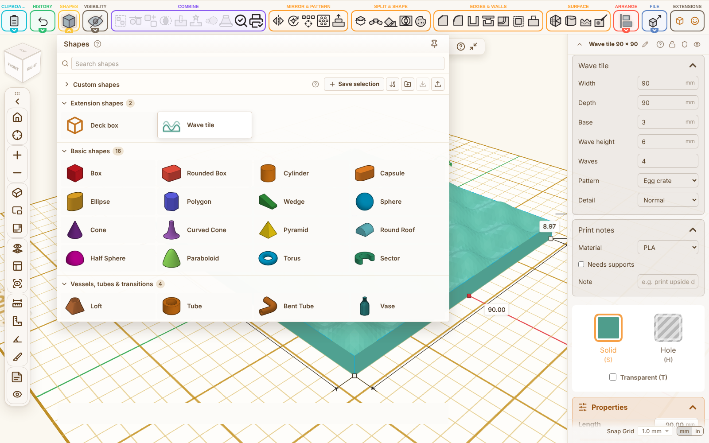
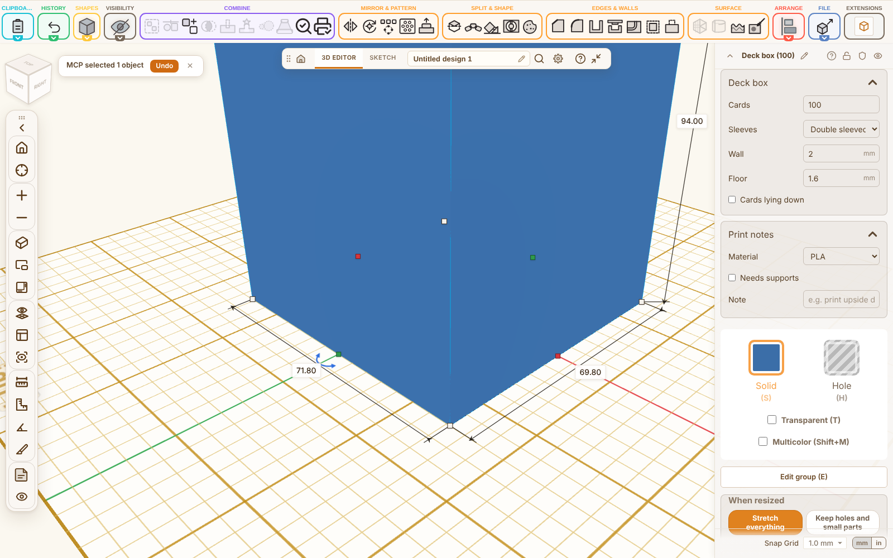
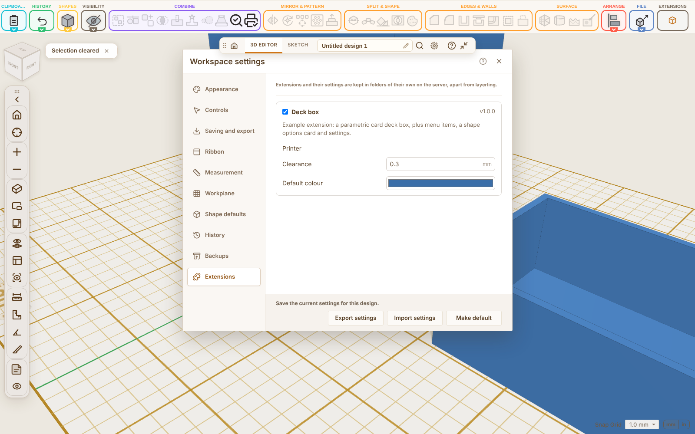

# layerling extensions

Add your own shapes, menu items, object options and settings to a self-hosted
[layerling](https://github.com/henmedia/layerling), without forking it.

Extensions are plain JavaScript files in a folder of their own. Their settings are kept in another folder. Neither
lives inside layerling, so you can update layerling whenever you like and your extensions stay where they are.



> This is a community add-on, not part of layerling and not made by its authors. It patches a few lines into
> layerling at build time. The aim is to propose those hooks upstream once they've been tested; until then, please
> report problems here, not to layerling.

## Contents

- [What extensions can do](#what-extensions-can-do)
- [Requirements](#requirements)
- [Quick start](#quick-start)
- [Installing extensions](#installing-extensions)
- [Configuration](#configuration)
- [Updating layerling](#updating-layerling)
- [Writing an extension](#writing-an-extension)
- [API reference](#api-reference)
- [Developing without Docker](#developing-without-docker)
- [Troubleshooting](#troubleshooting)
- [How it works](#how-it-works)
- [Security](#security)
- [Limitations](#limitations)
- [License](#license)

## What extensions can do

| | Where it shows up |
|---|---|
| **Custom shapes** | An *Extension shapes* section in the shape library. Built from layerling's own shapes (boxes, cylinders, threads, text, gears ...; holes are cut by grouping) or from a triangle mesh you generate. Their options appear in the inspector and rebuild the shape in place. |
| **Menu items** | The right-click menu on objects, the command search (Ctrl+K), an *Extensions* group in the ribbon, and the ⋮ menu of a design on the dashboard. |
| **Options for any object** | Extra cards in the inspector. The values are stored on the object and saved with the design, including in .lyl files. |
| **Settings** | A section per extension under *Settings → Extensions*, where each extension can also be switched on or off. |
| **Editor commands** | Extensions can run every command layerling's MCP server offers: create, move, group, cut, fillet, hollow, pattern ... |

| Options in the inspector | Settings → Extensions |
|---|---|
|  |  |

Three examples come with it, in [`extensions/`](extensions):

| Example | Shows |
|---|---|
| [`hello-world`](extensions/hello-world/index.js) | The minimum: a toolbar button, a right-click item that lines objects up, one setting. **Copy this to start.** |
| [`deck-box`](extensions/deck-box/index.js) | A parametric card deck box built from layerling's own shapes, an "Add a slip lid" right-click item, a *Print notes* card for every object, and settings. Uses every part of the API. |
| [`wave-tile`](extensions/wave-tile/index.js) | A shape made from a generated mesh (a tile with a wavy top), split across modules, with an icon file and its own CSS. |

## Requirements

- **Docker** with Compose v2 (`docker compose`): Docker Desktop on macOS or Windows, or Docker Engine on Linux.
- **git** and **bash**. On Windows, run everything in **WSL** (Ubuntu or similar), with Docker Desktop's WSL
  integration switched on.
- About 4 GB of free memory and a few minutes for the first build; layerling is built from source.

## Quick start

```bash
git clone https://github.com/westcoastdigital/layerling-extensions.git
cd layerling-extensions
scripts/update.sh
```

`update.sh` clones layerling into `core/`, adds the extension host, builds the image and starts it. Open
**http://localhost:3000** and create a design: the *Extensions* group sits at the right end of the ribbon, and the
example shapes are at the top of the shape library.

On **Linux** (including Fedora), let the container write the settings folder first. The container runs as user 999:

```bash
sudo chown -R 999:999 extension-data
```

Docker Desktop on macOS and Windows needs nothing.

### Folder layout

```
layerling-extensions/
├── extensions/              your extensions, one folder each            → /extensions in the container (read-only)
├── extension-data/          their settings, written by layerling         → /extension-data in the container
├── core/                    layerling itself, made by update.sh (git-ignored; don't edit, it is reset on update)
├── overlay/                 the extension host: new files copied into core/
├── patches/
│   └── extension-hooks.patch   the hooks: 24 lines in 9 layerling files
├── scripts/
│   ├── update.sh            get layerling, add the host, build and start
│   └── apply.sh             add the host to any layerling checkout
└── docker/compose.yml
```

## Installing extensions

1. Put the extension's folder in `extensions/`. The folder must hold an `extension.json`.
2. Reload the page.

No rebuild and no restart are needed: the list of extensions is read on every page load. To remove one, delete its
folder. To switch one off without deleting it, untick it under *Settings → Extensions* and reload.

The folder name is the extension's id. Its settings are saved in `extension-data/<folder name>.json`.

## Configuration

`docker/compose.yml` sets these for you:

| Variable | Default in compose | Purpose |
|---|---|---|
| `LAYERLING_EXTENSIONS_DIR` | `/extensions` | Where extensions are loaded from. Unset: no extensions. |
| `LAYERLING_EXTENSION_DATA_DIR` | `/extension-data` | Where settings and the on/off list are saved. Unset: they are kept in each browser instead. |
| `LAYERLING_PORT` | `3000` | The port on your machine: `LAYERLING_PORT=8080 scripts/update.sh`. |

Every option of layerling's own `docker/compose.yml` works here too: a shared projects folder, a default theme, simple
mode, MCP access, reverse proxy settings. Copy the lines you need from `core/docker/compose.yml` into
`docker/compose.yml`. They are documented in [layerling's README](https://github.com/henmedia/layerling#readme).

To restart after changing compose settings, without updating layerling:

```bash
docker compose -f docker/compose.yml up -d
```

## Updating layerling

```bash
scripts/update.sh                           # the latest layerling (main)
LAYERLING_REF=v1.165.2 scripts/update.sh    # a release tag, branch or commit
scripts/update.sh --no-build                # prepare core/ only, don't build
```

Each update resets `core/` to a clean copy of layerling, adds the extension host again and rebuilds. `extensions/` and
`extension-data/` are never touched.

### If the patch doesn't apply

layerling changes often. Each hook is one or two lines, so the patch usually applies as is, or with a 3-way merge that
the script tries by itself. If layerling has moved code too far, the script stops with conflict markers left in
`core/`. Then:

1. Open the files it names. The [hook points table](#hook-points) shows what each hook should look like.
2. Fix them, then save the result as the new patch:
   ```bash
   cd core && git diff > ../patches/extension-hooks.patch && cd ..
   ```
3. Build: `docker compose -f docker/compose.yml up -d --build`.

Or pin the last version that worked (`LAYERLING_REF=...`) and open an issue here.

## Writing an extension

### 1. Make a folder

```
extensions/my-tools/
├── extension.json
└── index.js
```

The quickest start is to copy `extensions/hello-world` and rename it.

### 2. Describe it in extension.json

```json
{
  "name": "My tools",
  "version": "1.0.0",
  "description": "Shown under Settings → Extensions.",
  "author": "Your name",
  "main": "index.js",
  "styles": ["style.css"],
  "layerling": "1.165.2"
}
```

Only `name` is needed. `main` defaults to `index.js`. `styles` is a list of CSS files to add to the page. `layerling`
is just a note of the version you tested with.

### 3. Export a function from index.js

```js
export default function activate(layerling) {
  layerling.registerMenuItem({
    id: "hello",
    label: "Say hello",
    menu: ["toolbar", "commandPalette"],
    run: () => layerling.notify("Hello from my extension"),
  });
}
```

layerling calls it once when the page loads and passes in the API. It's an ordinary ES module running in the browser:
no build step, no bundler. Import other files from your folder with relative paths
(`import { thing } from "./thing.js"`), as `wave-tile` does.

### 4. Reload the page

Changes show after a reload. Errors appear in the editor's message bar and in the browser console (F12), prefixed with
`[layerling extension <id>]`. An extension that fails to load is marked under *Settings → Extensions* and leaves
layerling running.

### Coordinates

All sizes are in **mm**.

- In shapes and commands, `x` is left/right, `z` front/back and `elevation` the height of the bottom above the plate.
  `x` and `z` are the centre of the object's footprint. `width` runs along x, `depth` along z, `height` up.
- In meshes, `y` is up and `z` points towards the front: positions are `[x, y, z, x, y, z, ...]`, three corners per
  triangle, counter-clockwise when seen from outside.

## API reference

The full TypeScript types are in
[`overlay/apps/web/src/lib/extensions/types.ts`](overlay/apps/web/src/lib/extensions/types.ts).

### `activate(layerling)`

Runs once when the page loads, on the dashboard as well as in the editor. It can be `async`. If it returns a function,
that function is called when the extension is disposed.

| Property | |
|---|---|
| `layerling.id` | The extension's id (its folder name). |
| `layerling.manifest` | The contents of `extension.json`. |
| `layerling.asset(path)` | The URL of a file in your folder, e.g. `layerling.asset("icon.svg")`. |
| `layerling.notify(message)` | Shows a message: in the editor's message bar, or at the bottom of the dashboard. |
| `layerling.onDispose(fn)` | Registers clean-up. |

### Option fields

Shapes, object options and settings all describe their fields the same way:

```js
{ key: "cards", label: "Cards", type: "number", default: 100, min: 10, max: 400, step: 1, unit: "mm", help: "Tooltip" }
{ key: "sleeves", label: "Sleeves", type: "select", default: "double", options: [{ value: "double", label: "Double" }] }
{ key: "landscape", label: "Lying down", type: "boolean", default: false }
{ key: "note", label: "Note", type: "text", default: "", placeholder: "e.g. print upside down" }
{ key: "color", label: "Colour", type: "color", default: "#3b6ea8" }
```

Number and text fields commit on Enter or when you leave them; the others commit at once. Numbers are clamped to
`min`/`max` and rounded to `step`.

### `registerShape(definition)`

Adds a shape to the *Extension shapes* section of the library.

```js
layerling.registerShape({
  id: "deck-box",                 // unique within your extension
  name: "Deck box",
  icon: "<svg ...>",              // SVG markup or a URL (layerling.asset("icon.svg")); optional
  keywords: ["mtg", "cards"],     // also found by these in the library search
  options: [/* option fields */],
  build(values, { settings, previous }) {
    // values: the options; settings: your extension's settings; previous: the old object when rebuilding
    return { name: "Deck box", color: "#3b6ea8", parts: [/* ... */] };   // or { mesh: { ... } }
  },
});
```

`build` can be `async`. It returns one of two things.

**Parts**, made from layerling's own shapes:

```js
return {
  name: "Box with a pocket",     // optional, defaults to the shape's name
  color: "#3b6ea8",              // optional
  parts: [
    { kind: "box", width: 40, depth: 30, height: 20, x: 0, z: 0, elevation: 0 },
    { kind: "cylinder", hole: true, width: 8, depth: 8, height: 20, x: 0, z: 0, elevation: 4 },
  ],
};
```

A part takes everything layerling's `create_shape` command takes. That covers every shape kind and its own settings:
threads, gears, text, Gridfinity bins, hinges, springs, port openings ... The parameters are documented in
`core/scripts/layerling-mcp-tools.mjs` under `layerling_create_shape`. Two or more parts are grouped, so parts with
`hole: true` cut the others.

**A mesh**, which you generate:

```js
return {
  name: "Wave tile",
  mesh: { positions: [/* x, y, z per corner, 3 corners per triangle */], normals: [/* optional */] },
};
```

Make it closed and wound counter-clockwise from outside if it will be printed or cut.
[`wave-tile/heightfield.js`](extensions/wave-tile/heightfield.js) is a worked example.

**Rebuilding.** When someone changes an option in the inspector, the shape is built again, put where the old one stood
(position and rotation), and the old one is removed. A name typed by hand and the colour are kept; a name your `build`
gave follows the new values.

### `registerMenuItem(definition)`

```js
layerling.registerMenuItem({
  id: "copy-size",
  label: "Copy size",
  menu: ["shapeContext", "commandPalette", "toolbar", "dashboardProject"],  // one or several
  icon: "<svg ...>",            // toolbar, command search and dashboard menu
  shortcut: "Ctrl+Alt+C",       // shown only; register the key yourself if you want one
  keywords: ["dimensions"],     // command search
  danger: false,                // red, for destructive items (right-click menu)
  separated: false,             // a line above it (right-click menu)
  when: (ctx) => ctx.selected.length === 1,  // hidden when false
  enabled: (ctx) => true,                    // greyed out when false (toolbar, command search, dashboard)
  run: async (ctx) => { /* ... */ },
});
```

| Menu | Where |
|---|---|
| `shapeContext` | Right-clicking an object, below layerling's own items |
| `commandPalette` | Ctrl+K command search, grouped under your extension's name |
| `toolbar` | The *Extensions* ribbon group (hidden in simple mode) |
| `dashboardProject` | The ⋮ menu of a design on the start page |

`ctx` holds `menu`, `selection` (ids), `selected` (the selected objects) and, in `dashboardProject`, `projectId` and
`projectName`.

### `registerShapeOptions(definition)`

Adds a card to the inspector for objects you choose, whoever made them.

```js
layerling.registerShapeOptions({
  id: "print-notes",
  title: "Print notes",
  appliesTo: (shape) => !shape.hole,
  options: [/* option fields */],           // or (shape) => [/* fields depending on the object */]
  apply: async (shape, values, { settings }) => {
    // optional: change the design to match, e.g. with layerling.editor.run(...)
  },
});
```

The values are stored on the object and saved with the design. Read them back with
`layerling.editor.data(id)?.panels?.["print-notes"]`.

### `registerSettings(definition)` and `layerling.settings`

```js
layerling.registerSettings({ title: "Printer", options: [/* option fields */] });

layerling.settings.all();                          // every value, defaults filled in
layerling.settings.get("clearance");
await layerling.settings.set("clearance", 0.4);
const stop = layerling.settings.onChange((values) => { /* ... */ });
```

They appear under *Settings → Extensions* and are saved to `extension-data/<id>.json`.

### `layerling.editor`

| | |
|---|---|
| `available()` | `false` on the dashboard, where no design is open. |
| `run(command, params)` | Runs a layerling command and returns its result (see below). |
| `shapes()` | Every object in the design. |
| `selection()` | The ids of the selected objects. |
| `shape(id)` | One object, or `null`. |
| `data(id)` / `setData(id, data)` | Your extension's own data on an object, saved with the design. `data` is `{ shape?, values?, panels?, data? }`; keep your own things under `data`. |
| `insertShape(shapeId, values?, place?)` | Inserts one of your registered shapes; returns the new object's id. `place` is `{ x, z, elevation }`. |
| `on("change", fn)` | Called after the objects or the selection change, at most once per frame. Returns a function that stops it. |

#### Commands

`run()` takes the commands of layerling's MCP server, without the `layerling_` prefix, with the same parameters. They
are documented in `core/scripts/layerling-mcp-tools.mjs`. Some useful ones:

```js
const { object } = await layerling.editor.run("create_shape", { kind: "cylinder", width: 10, depth: 10, height: 5 });
await layerling.editor.run("update_object", { id: object.id, x: 20, color: "#cc3333", name: "Peg" });
await layerling.editor.run("group_objects", { ids: [a, b] });
await layerling.editor.run("select_objects", { ids: [object.id] });
await layerling.editor.run("delete_objects", { ids: [object.id] });
await layerling.editor.run("import_mesh", { positions, name: "Mesh" });
await layerling.editor.run("list_objects");
await layerling.editor.run("get_scene");
```

Commands that make an object return `{ object: { id, name, ... } }`. A command that fails throws, and layerling shows
the reason in its message bar. Each command is one undo step.

## Developing without Docker

For quicker turnaround while writing extensions, run layerling's dev server (Node 22.18 or later):

```bash
scripts/update.sh --no-build
cd core
npm ci
LAYERLING_EXTENSIONS_DIR=../extensions LAYERLING_EXTENSION_DATA_DIR=../extension-data npm run dev
```

On Windows PowerShell, set the two variables with `$env:NAME = "value"` first.

## Troubleshooting

**No *Extensions* group, no *Extension shapes*.** Make sure you're on the container built by `update.sh` and not the
ready-made layerling image: open `http://localhost:3000/api/extensions`. You should see a JSON list. A 404 means the
host isn't in the build; run `scripts/update.sh` again. An empty list means `LAYERLING_EXTENSIONS_DIR` isn't set or
the folder isn't mounted.

**My extension is listed but does nothing.** Look under *Settings → Extensions*: a failed extension shows its error
there. Check the browser console for `[layerling extension ...]`. The usual causes are a syntax error, no
`export default`, or an import path without `./`.

**Settings don't save / "Saving the settings failed (500)".** The container can't write `extension-data/`. On Linux:
`sudo chown -R 999:999 extension-data`.

**Changes to my extension don't show.** Reload the page. If an old version sticks, do a hard reload (Ctrl+Shift+R /
Cmd+Shift+R).

**Port 3000 is already in use.** `LAYERLING_PORT=8080 scripts/update.sh`.

**Fedora: permission denied reading the folders.** The mounts carry `:z` for SELinux. If you changed them, add it back.

**The patch no longer applies.** See [If the patch doesn't apply](#if-the-patch-doesnt-apply).

## How it works

- A server route, `/api/extensions`, lists the folders in `LAYERLING_EXTENSIONS_DIR` and saves settings to
  `LAYERLING_EXTENSION_DATA_DIR`. Files are served from `/api/extensions/files/<id>/...`.
- `ExtensionHost`, mounted once in the layout, fetches that list and loads each extension's `main` with `import()`.
- The editor hands extensions the same command runner its MCP server uses, plus the objects and the selection.
- A handful of slots render what extensions register: in the menus, the library, the inspector and the settings.
- Data an extension keeps on an object goes in `shape.extensions[<id>]`. layerling keeps unknown fields, so it is saved
  in the browser, in .lyl files and in the undo history. layerling without extensions ignores it.

### Hook points

These are the only changes to layerling's own files. Everything else is new files under `overlay/`.

| File (under `apps/web/src/`) | Hook |
|---|---|
| `app/layout.tsx` | `<ExtensionHost />` after `<NewVersionNotice />` |
| `app/page.tsx` | `<ExtensionProjectMenuItems ... />` at the top of the design's ⋮ menu |
| `components/LayerlingEditor.tsx` | `useExtensionEditorBridge({ ... })` after the effect that sets `executeMcpCommandRef` |
| `components/workplane/CommandPalette.tsx` | `const commands = useExtensionPaletteCommands(coreCommands);` |
| `components/workplane/SecondaryToolbar.tsx` | `<ExtensionToolbarSection />` after the shapes section |
| `components/workplane/ShapeContextMenu.tsx` | `const items = useExtensionContextMenuItems(coreItems);` |
| `components/workplane/ShapeInspector.tsx` | `<ExtensionShapeOptions shape={shape} disabled={frozen} />` at the top of the cards |
| `components/workplane/ShapeLibraryList.tsx` | `<ExtensionShapeSection />` after the custom shapes |
| `components/workplane/WorkspaceSettingsModal.tsx` | The *Extensions* tab: section type, nav button, content |

Each file also gets one `import` line.

## Security

Extensions run in the page with the same access as layerling itself: they can read and change every design open in
the browser. **Only install extensions you trust and have read.** The server serves only files inside each
extension's folder (no dotfiles, no paths outside it), mounts the folder read-only, and refuses settings changes from
other sites.

## Limitations

- Inserting an extension shape made of parts takes several undo steps: one per part, the group and the name.
- Rebuilding a shape from its options replaces the object, so it gets a new id.
- An object made by an extension that's later removed keeps its geometry but loses its options card.
- The static export build (`npm run export`) isn't supported; this is for the server and Docker build.
- Labels added by the host ("Extensions", "Extension shapes") are English only for now.

## Contributing

Issues and pull requests are welcome, especially:

- hooks that no longer apply after a layerling update (with the layerling version);
- extensions worth adding as examples;
- places in layerling that should accept extensions but don't yet.

## License

[AGPL-3.0](LICENSE), the same as layerling, since the host is built into it. This project puts no licence terms
on extensions you write.

layerling is © its contributors, [github.com/henmedia/layerling](https://github.com/henmedia/layerling).
